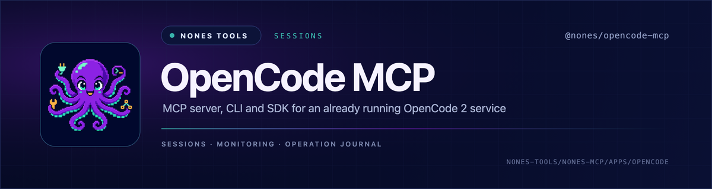

[](https://github.com/nones-tools/nones-mcp/tree/main/apps/opencode)

> **Current source and releases:** [OpenCode MCP in the Nones MCP monorepo](https://github.com/nones-tools/nones-mcp/tree/main/apps/opencode).

# OpenCode MCP

`@nones/opencode-mcp` is a local MCP server, Node CLI, and TypeScript SDK for an **already running** OpenCode 2 service. The compatibility target is OpenCode 2.4.1. It connects to the managed service that is already there and never starts, restarts, or replaces it. Node 22.14 or newer is required for the packaged CLI.

## Quick start

```sh
npm install -g @nones/opencode-mcp
opencode-mcp server start
opencode-mcp doctor
opencode-mcp start -C . -f prompt.txt
```

The npm package installs two equivalent bin names, `opencode-mcp` and `oc2-mcp`, both pointing at the same `dist/cli.js`. `opencode-mcp mcp` runs the stdio MCP server and is the default when no command is given. `server start [--timeout <seconds>] [--opencode-bin <path>]` reuses a ready managed service or launches `opencode2 service start`, proves a real MCP handshake, and never restarts, stops, or replaces a service; `mcp` and `doctor` never auto-start. `doctor` reads `server.info` and prints indented JSON without credentials. `help`, `--help`, `-h`, `--version`, and `-V` work without an OpenCode connection.

## Session CLI

Session commands use the running OpenCode service directly. They keep no local job database, require no Python, and do not install background monitors. CLI actions also append best-effort records to a local operation journal (see [Operation journal](#operation-journal)); journaling never changes a native result or exit code.

A `ses_...` session ID is the handle: it is the native session, not the old wrapper's job ID. `send` never creates a fresh session, and a missing ID is an error rather than a reason to fork or recreate one.

### Start and steer

```sh
opencode-mcp start -C . -f prompt.txt --title "Review the change"
printf 'Also run the focused tests' | opencode-mcp start -C . -f -
```

`start` resolves the working directory, reads and validates the prompt, creates a native session, and submits with `delivery: steer`. It exits after the native admission receipt. The model resolves in this order: `--model`, `OPENCODE_MCP_MODEL`, legacy `OC2_MODEL`, then `opencode-go/deepseek-v4.1-flash`. A model is written as `provider/id` with an optional `#variant`, for example `opencode-go/deepseek-v4.1-flash#high`. Models and variants are checked against the native catalogue; invalid values fail without falling back. Fresh directories may have no project-scoped catalogue yet: unscoped mode falls back to the global native catalogue, while scoped mode stays location-only and fails closed. If session creation succeeds but prompt submission fails, the error keeps the created session ID.

```sh
opencode-mcp send ses_example -f steer.txt
printf 'Queue this next' | opencode-mcp send ses_example -f - --delivery queue
```

`send` submits immediately to the owning service and session, defaults to `steer`, prints the admission receipt, and does not wait for a turn.

### Inspect sessions

```sh
opencode-mcp sessions --limit 10
opencode-mcp status ses_example
opencode-mcp messages ses_example --limit 20
opencode-mcp messages ses_example --cursor "<native cursor>"
```

`sessions` lists bounded native IDs with title, directory, outcome, and update time. `status` prints current native metadata. `messages` returns the latest native messages newest first plus the upstream cursor; pass the cursor without an order.

### Monitor a turn

```sh
opencode-mcp monitor ses_example --until-turn --timeout 300
opencode-mcp watch ses_example
opencode-mcp run -C . -f prompt.txt --timeout 600
```

`monitor` (alias `watch`) writes newline-delimited JSON to stdout: an initial status, filtered real native events, and normalized `turn-start`, `steer-delivered`, `tool-completed`, `idle`, `success`, `failure`, and `timeout` events. Every event carries the session ID and any available message ID. Delta and progress chunks are omitted.

The native live SSE stream has no replay. The monitor therefore performs short bounded reads (about one second) and reconciles with `session.get`, using native `time.busy`, `time.idle`, and execution outcome to cover reconnect or gap losses. It never treats the admission receipt or an old outcome as completion. An attach to a busy session with `--until-turn` finishes after that turn; an attach to an idle session waits for the next turn. Without `--until-turn`, successful and failed turns are reported and observation continues with the next turn. `Ctrl+C` stops observation without interrupting the native session.

`run` composes start and until-turn monitoring. It prints the started line with the session ID and admission receipt immediately, takes the created-session metadata as the observation baseline before delivery, and reconciles a turn that completes before the first stream read.

Monitor exit codes: `0` turn succeeded, `2` turn failed or was interrupted in `--until-turn` mode, `124` timeout, `130` stopped by signal, `1` validation, connection, or protocol failure. Monitor stdout is protocol data only; diagnostics go to stderr.

## Operation journal

The CLI records native action outcomes in a local SQLite database. MCP stdio, help, and version never open it. Logged operations are `opencode.session.start/send/run/monitor/status/messages/sessions` and `opencode.service.start`. Records include the UTC start time, duration, outcome, and native session ID, title, and message ID when known. Authorized prompt text is stored only for `start`, `send`, and `run`, and only while prompt capture is enabled.

Configuration is read from `OPENCODE_MCP_CONFIG`, otherwise `$XDG_CONFIG_HOME/nones/config.json` (fallback `~/.config/nones/config.json`):

```json
{
  "journal": {
    "enabled": true,
    "capturePrompts": true,
    "sqlitePath": "/optional/absolute/journal.sqlite",
    "adapter": {
      "module": "./journal-adapter.mjs",
      "options": {}
    }
  }
}
```

The default database is `$XDG_STATE_HOME/nones/journal.sqlite` (fallback `~/.local/state/nones/journal.sqlite`). New state directories are `0700` and new database files `0600` on POSIX; an existing database with group or other permissions is refused rather than silently chmodded. `sqlitePath` and `adapter` are mutually exclusive. Other top-level keys are ignored so a monorepo can share one config file.

Read the journal explicitly; there is no automatic deletion command:

```sh
opencode-mcp journal list --operation-prefix opencode.session. --limit 20
opencode-mcp journal stats --outcome failure --from 2026-01-01T00:00:00.000Z
opencode-mcp journal list --include-prompts
```

`journal list` omits prompt text unless `--include-prompts` is given. Filters are bounded and `--cursor` continues a page. `journal stats` reports counts and average durations without prompts.

Set `"capturePrompts": false` to keep prompt bodies out of the journal. A custom adapter is trusted, locally installed executable code selected only by explicit configuration; it is never discovered from a project directory or downloaded. Relative module paths resolve from the config file. Custom adapter exceptions and remote-driver details are not echoed by the CLI; journal commands report a generic safe summary, while configuration syntax and field validation remain actionable.

Package exports:

- `@nones/opencode-mcp` — MCP server, client, and SDK.
- `@nones/opencode-mcp/journal` — versioned journal contracts (`JOURNAL_API_VERSION`, `JournalAdapter`, `JournalAdapterFactory`), config loader, and runtime helpers for custom adapters.

Minimal custom adapter:

```ts
import type { JournalAdapterFactory } from "@nones/opencode-mcp/journal";

export default {
  apiVersion: 1,
  create(options) {
    return {
      apiVersion: 1,
      async record(record) {
        // Send record to the trusted local store.
        return { id: record.id, inserted: true };
      },
      async query() {
        return { records: [], next: null };
      },
      async stats() {
        return {
          total: 0,
          firstAt: null,
          lastAt: null,
          byOutcome: [],
          byOperation: [],
        };
      },
      async close() {},
    };
  },
} satisfies JournalAdapterFactory;
```

Journaling is best-effort and bounded (100 ms by default). A custom or remote adapter cannot change a successful native result, make a native failure look different, or delay receipt output indefinitely. For `send`, the title lookup happens after admission, is bounded, and is skipped when journaling is disabled.

On Node 22, the built-in `node:sqlite` module can print `ExperimentalWarning: SQLite is an experimental feature` to stderr when the journal first opens. This project does not suppress warnings; stdout and native JSON output remain unchanged.

## Set up with an agent

Copy this prompt into your MCP-capable coding agent, replacing `<client name>` with the client you intend to configure:

```text
Set up @nones/opencode-mcp for <client name> on this machine.
1. Confirm Node 22.14+ and an already running OpenCode 2 service. Never start or replace the service.
2. Install the latest stable package globally with npm install -g @nones/opencode-mcp.
3. Register a user-level stdio MCP server with id opencode2 using <client name>'s documented configuration method. Preserve unrelated entries, reuse an equivalent registration, and verify no duplicates.
4. Use the host-accessible executable (absolute path if needed) with argument mcp. Keep managed discovery and add service file, URL, or auth overrides only if this setup needs them. Do not expose credential values in docs, arguments, logs, or config.
5. Keep destructive, admin, and exec capabilities off. Run opencode-mcp doctor, then confirm the client can call the MCP tool opencode_server_info.
6. Report install and config locations and whether the client needs a restart.
```

## Client registration

Codex:

```sh
codex mcp add opencode2 -- opencode-mcp mcp
```

```toml
[mcp_servers.opencode2]
command = "opencode-mcp"
args = ["mcp"]
```

Generic stdio client:

```json
{
  "mcpServers": {
    "opencode2": {
      "command": "opencode-mcp",
      "args": ["mcp"]
    }
  }
}
```

## Connection and configuration

With no configuration, the CLI discovers the authenticated managed service through `@opencode/client/service`. `OPENCODE_MCP_SERVICE_FILE` can point to a non-default registration file. An explicit endpoint uses `OPENCODE_MCP_URL` and, when needed, Basic authentication as user `opencode`.

| Variable                         | Purpose                                                                                                                                                |
| -------------------------------- | ------------------------------------------------------------------------------------------------------------------------------------------------------ |
| `OPENCODE_MCP_URL`               | Use an explicit endpoint instead of discovery. Loopback is the default; a remote host requires HTTPS and `OPENCODE_MCP_ALLOW_REMOTE=1`.                |
| `OPENCODE_MCP_PASSWORD`          | Basic-auth password for user `opencode` when `OPENCODE_MCP_URL` is set. Pass it through the environment, never a committed config or command argument. |
| `OPENCODE_MCP_SERVICE_FILE`      | Path to an OpenCode-managed service registration passed to the discovery adapter.                                                                      |
| `OPENCODE_MCP_ALLOW_REMOTE`      | Set to `1` to allow a remote HTTPS endpoint.                                                                                                           |
| `OPENCODE_MCP_TIMEOUT_MS`        | Request timeout from 100 to 120000 ms. Default: 30000.                                                                                                 |
| `OPENCODE_MCP_ALLOWED_DIRS`      | Platform path-delimited list of existing directories that bounds project and session scope.                                                            |
| `OPENCODE_MCP_MODEL`             | Default session model; legacy `OC2_MODEL` is read next, then the built-in default.                                                                     |
| `OPENCODE_MCP_ALLOW_DESTRUCTIVE` | Set to `1`, plus per-call `confirm: true`, to allow deletion, filesystem writes, and rollback/commit operations.                                       |
| `OPENCODE_MCP_ALLOW_ADMIN`       | Set to `1`, plus `confirm: true`, to allow plugin updates, global configuration, and other unclassified mutations.                                     |
| `OPENCODE_MCP_ALLOW_EXEC`        | Set to `1`, plus `confirm: true`, to allow explicit shell, command, and PTY operations.                                                                |

Capability flags enable only when the value is exactly `1`; any other value leaves the capability off. Confirmation must be exactly `true`.

## Safety and scope

- Requests use the configured origin, reject redirects, and are bounded by timeout and response size. A timed-out mutation may already have completed; check its outcome before retrying.
- `OPENCODE_MCP_ALLOWED_DIRS` is checked against canonical paths. Session and project lists are filtered to allowed workspaces, creation requires an allowed `body.location.directory` and checks any parent session, and unverifiable scope fails closed. Native model discovery is admitted only when `query.location.directory` is explicitly present and canonicalizes inside the allowlist. The scope filter is not a multi-user isolation boundary; all projects and chats on the attached server are visible by default.
- Credential, authorization provisioning, pairing, and RPC tunnel routes are excluded, and sensitive fields are stripped from responses and errors.
- MCP clients can see chat content and tool output, so attach only trusted clients. Never put passwords in command arguments or committed configuration.

## Tools

| Tool                      | Use                                                                                                                               |
| ------------------------- | --------------------------------------------------------------------------------------------------------------------------------- |
| `opencode_operations`     | List discovered native operation IDs, methods, paths, parameter names, and safety categories. Optional `filter` narrows the list. |
| `opencode_request`        | Call exact operation ID with `{ operation, path?, query?, body?, confirm? }`.                                                     |
| `opencode_<operation_id>` | Call a native operation directly. Dots and other unsupported characters in the ID become underscores.                             |
| `opencode_history`        | Group native messages by user prompt with `{ sessionID, cursor?, limit? }`.                                                       |
| `opencode_events`         | Read a bounded slice of live or per-session log events with `{ sessionID?, source?, types?, after?, limit?, durationMs? }`.       |

## Examples

List operations with `opencode_operations`:

```json
{ "filter": "session" }
```

Steer an existing session:

```json
{
  "path": { "sessionID": "ses_example" },
  "body": { "text": "Please also run the focused tests.", "delivery": "steer" }
}
```

Read grouped history:

```json
{ "sessionID": "ses_example", "limit": 50 }
```

Read a bounded live event slice:

```json
{
  "sessionID": "ses_example",
  "source": "live",
  "types": ["session.idle"],
  "durationMs": 5000
}
```

For the native per-session log, use `source: "log"` with `after`. A log cursor is not valid for the global stream; the live stream cannot replay missed events. Streams are bounded by `limit` (1–200), `durationMs` (100–30000), and response size.

## TypeScript SDK

```ts
import { OpenCodeClient } from "@nones/opencode-mcp";

const client = await OpenCodeClient.connect();
const info = await client.request({ operation: "server.info" });
```

The published declarations are self-contained per module and resolve for an external TypeScript `NodeNext` consumer. The root export is the SDK; `@nones/opencode-mcp/journal` exports the versioned journal adapter contract and runtime helpers described above.

## Upstream behavior

- Operation IDs, parameters, and experimental surfaces come from the connected server's `/openapi.json`; inspect `opencode_operations` rather than assuming a catalog entry exists.
- Session creation supports the native `parentID` body field when available. Parent linkage is never synthesized.
- `event.subscribe` and `experimental.session.log` are not available as direct operations; use `opencode_events`. The server never starts, restarts, replaces, or implicitly creates an OpenCode service, and it does not proxy credential, authorization, pairing, or RPC tunnel routes.
- Until OpenCode provides replay for the live stream, monitors reconcile through `session.get`; events lost while no read is attached may be absent from the event lines even when the final turn outcome is correct.

## Development

Bun 1.4.5 is the pinned build, formatting, and test runner; the published CLI runs on Node 22.14 or newer. Run `bun install --frozen-lockfile`, `bun run format:check`, `bun run lint`, `bun run typecheck`, `bun run build`, `bun test`, and `npm pack --dry-run`. `bun run test:package` packs the tarball, installs it into a fresh consumer, checks NodeNext declarations including the journal subpath, runs the installed Node CLI and journal commands with synthetic config, checks the `oc2-mcp` alias, and launches the installed build with Bun using `--no-env-file` for a bounded stdio MCP handshake and journal read. See [CONTRIBUTING.md](CONTRIBUTING.md) for architecture and review guidance.
